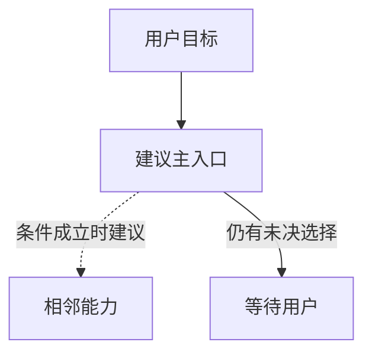

# 重编排方案参考

仅在多入口调整或新增 Skill 候选需要集中审阅时使用。删去不适用段落，不为模板补造历史、问题或新候选。

## 事实基线

记录分析范围、已读正文/配置及版本线索、用户目标；使用历史时单列授权范围和限制。

## 候选

| 问题与证据位置 | 建议变化 | 预期收益 | 代价/风险 | 所需决定 |
| --- | --- | --- | --- | --- |

精简项说明删除后哪个行为仍由哪里保证；跨 Skill 的相似边界不能因相似就删除。

## 新 Skill（有候选时）

- 重复工作的实际证据：
- 触发、输入、判断、输出与非目标：
- 现有入口为何不足：
- 正向请求、近似但不应触发的请求：
- 需验证的行为与失败条件：

## 建议工作流（关系复杂时）

本图是待采纳方案，不代表已安装或已生效。

## 执行范围

明确哪些变更已获准，哪些仍待选择。正文修改、删除、安装与更新清单分别说明范围；复用已有有效授权，不重复询问。
