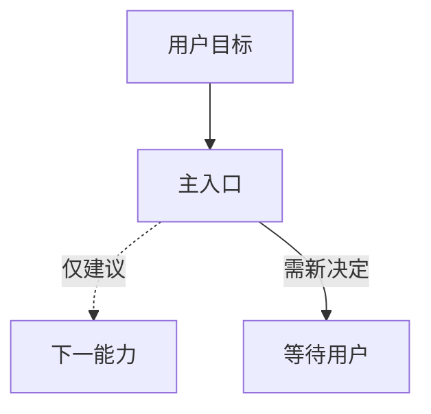

# 工作流文档参考

需要保存完整多 Skill 说明时使用。正文事实优先于模板，简单线性关系不必配图。

## 范围与依据

- 分析目录/作用域、读取的 Skill 与调用配置：
- 版本或检查日期：
- 未读取、缺失或无法确认的项：

## 快速选择

| 目标 | 主入口 | 触发/前提 | 输出 | 边界 |
| --- | --- | --- | --- | --- |

## 关系总览（需要时）

具体条件与证据放表格或图后，避免节点太长。只有复杂内部流程需要单独子图。

## 关键关口与证据

| Skill/关系 | 正文或配置位置 | 自动/建议/用户选择/外部执行 | 必需条件 |
| --- | --- | --- | --- |

## 发现与限制

记录已证实的旧图变化、当前冲突、未核实项与实际检查范围。不要用空表替代“已检查且未发现”。

## 历史模式（仅明确授权时）

记录时间/项目覆盖、聚合方法、频率或顺序观察，以及不能由这些观察推出的结论；不得将历史顺序画成强制流程。
